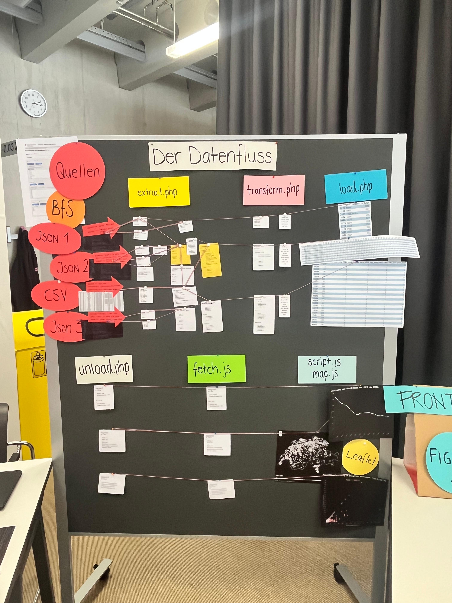

Dokumentation im ReadMe des GitHub-Repos
Kurze Beschreibung des Projekts mit folgenden Themen:
● Kurzbeschreibung des Projekts (ca. 500 Zeichen)
● Learnings
● Schwierigkeiten
● benutzte Ressourcen
● mindestens jeweils ein Screenshot in Mobile- und Desktop-Ansicht
● Foto des Marktstands

unbedingt erwähnen und begründen: weshalb wir welche entscheidungen getroffen haben bei fehlenden daten/messwerten.

Schwierigkeiten:

Hinweis: überall wo es bei gemeinden ab einem gewissen jahr null ist, ist das, weil diese gemeinden fusioniert worden sind. die werte (anzahl kinos) werden in der neuen gemeinde ausgehoben und gezählt. die fusionierten (alten) gemeinden tauchen nicht mehr auf der karte auf, weil es sie nicht mehr gibt, was korrekt ist.

Null angaben in dia3 sind aufgrund der fusionierten gemeinden

---

Über das Projekt

    Das Datenjournalismus-Projekt analysiert den tiefgreifenden Wandel der Schweizer Kinolandschaft von den 1960er-Jahren bis in die Gegenwart. Anhand historischer und aktueller Daten wird sichtbar gemacht, wie viele Kinos verschwunden sind, wie sich ihre Standorte verlagert und Kapazitäten verändert haben.

    Dieses Projekt entstand im Rahmen des Moduls Interaktive Medien III und wurde von den Studierenden Andrin Gerber, Benita Gautschi (Backend), Andri Csetreki und Jan Beatrix (Frontend) durchgeführt. Während die Backend-Entwickler die Daten beschafft, aufbereitet und bereitgestellt haben, gestalteten die Frontend-Entwickler daraus die visuelle Geschichte, die die Daten anschaulich und erlebbar macht.

Learnings

    - Code-Reusability steigern: Beispiel die Gemeinden die von BE zu JU gingen haben wir in einem langen codeblock mühsam fusioniert und im nachhinein hat und chat gesagt wir können das einfacher machen und wir haben 1 funktion daraus gemacht
    - zuerst gut planen und strukturieren (auf papier phsyisch), dann coden
    - ohne Ki coden macht mehr spass und man lernt mehr
    - umgang mit fehlenden werten -> man muss sich überlegen, wann es sinn macht, zb werte einfach zu verbinden wie diagramm1 oder so
    - datenflüsse visualieren auf papier (wie sieht dieser array wirklich aus)
    - zahlen in eine (spannende, aussagekräftige) geschichte umwandeln. diagramm so interpretieren, dass es etwas aussagt

Schwierigkeiten

    - Zu Beginn des Projekts waren wir etwas verloren mit den JSON-Dateien. Es dauerte etwas, um zu verstehen, welche Daten vorhanden sind und wie man diese lesen muss.  
    - Für einen Teil der Untersuchung wurde die Anzahl Kinos pro Gemeinde pro Jahr analysiert. Während des Projekts haben wir bemerkt, dass 1979 der Kanton Jura gegründet wurde und in diesem Rahmen sind einige Gemeinden vom Kanton Bern in den Kanton Jura übergegangen. Diese Gemeinden existierten im Datensatz deshalb zweifach, aber jeweils nur mit einem Teil der Daten. Dieses Problem mussten wir manuell beheben und die zwei Gemeinden (BE und JU) zu einer zusammenführen.
    - FRONTEND?
    - Eine weitere Herausforderung war es, die passenden Darstellungsformen für unsere Daten zu finden, sodass die Diagramme aussagekräftig und leicht verständlich, aber trotzdem vollständig und umfänglich sind.

Benutzte Ressourcen
    Backend:
    - Alle Daten zur Kinoinfrastruktur in der Schweiz stammen vom Bundesamt für Statistik ("Kinoinfrastruktur nach Gemeinde und Kinotyp"): https://statistik.admin.ch/de/asset/36476430 (JSON: https://www.pxweb.bfs.admin.ch/api/v1/de/px-x-1602010000_101/px-x-1602010000_101.px)
    - Für die Darstellung der Gemeinden auf der Karte waren die Koordinaten jeder Gemeinde nötig. Auch diese bezogen wir vom Bundesamt für Statistik: https://www.agvchapp.bfs.admin.ch/de/kennzahlen/results?SnapshotDate=01.01.2026&Unit=Communes&IncCentroid=True 
    - Zur Fehlerbehebung und Optimierung des Codes wurde KI verwendet (Copilot, Claude AI).
    
    Frontend:
    - ...
    - KI...

Screenshot

    Desktop:
    ADD
    
    Mobile:
    ADD

Marktstand

