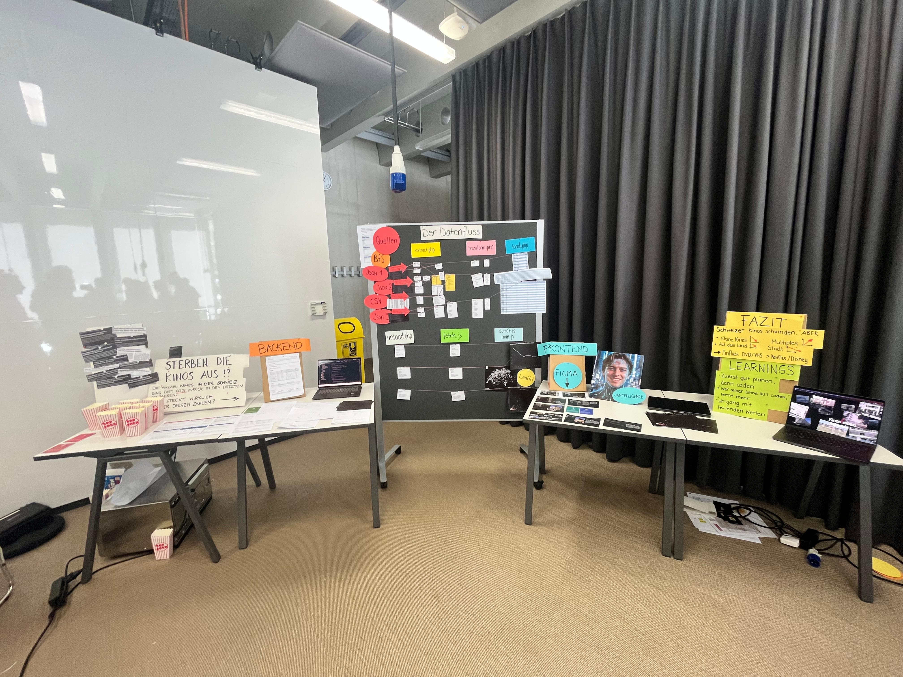

Dokumentation im ReadMe des GitHub-Repos
Kurze Beschreibung des Projekts mit folgenden Themen:
● Kurzbeschreibung des Projekts (ca. 500 Zeichen)
● Learnings
● Schwierigkeiten
● benutzte Ressourcen
● mindestens jeweils ein Screenshot in Mobile- und Desktop-Ansicht
● Foto des Marktstands

unbedingt erwähnen und begründen: weshalb wir welche entscheidungen getroffen haben bei fehlenden daten/messwerten.

Schwierigkeiten:
Wir haben bemerkt, dass einige Gemeinden fusioniert wurden und daher nicht alle Daten (korrekt) angezeigt werden. Diese Problem mussten wir manuell beheben.

Hinweis: überall wo es bei gemeinden ab einem gewissen jahr null ist, ist das, weil diese gemeinden fusioniert worden sind. die werte (anzahl kinos) werden in der neuen gemeinde ausgehoben und gezählt. die fusionierten (alten) gemeinden tauchen nicht mehr auf der karte auf, weil es sie nicht mehr gibt, was korrekt ist.

Null angaben in dia3 sind aufgrund der fusionierten gemeinden

---

Über das Projekt

    Das Datenjournalismus-Projekt analysiert den tiefgreifenden Wandel der Schweizer Kinolandschaft von den 1960er-Jahren bis in die Gegenwart. Anhand historischer und aktueller Daten wird sichtbar gemacht, wie viele Kinos verschwunden sind, wie sich ihre Standorte verlagert und Kapazitäten verändert haben.

    Dieses Projekt entstand im Rahmen des Moduls Interaktive Medien III und wurde von den Studierenden Andrin Gerber, Benita Gautschi (Backend), Andri Csetreki und Jan Beatrix (Frontend) durchgeführt. Während die Backend-Entwickler die Daten beschafft, aufbereitet und bereitgestellt haben, gestalteten die Frontend-Entwickler daraus die visuelle Geschichte, die die Daten anschaulich und erlebbar macht.

Learnings

    Code-Reusability steigern: Beispiel die Gemeinden die von BE zu JU gingen haben wir in einem langen codeblock mühsam fusioniert und im nachhinein hat und chat gesagt wir können das einfacher machen und wir haben 1 funktion daraus gemacht

Schwierigkeiten

Marktstand

